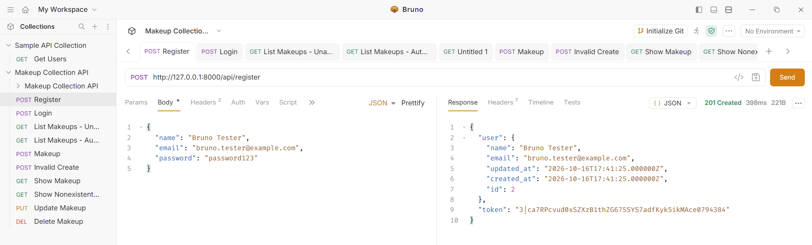
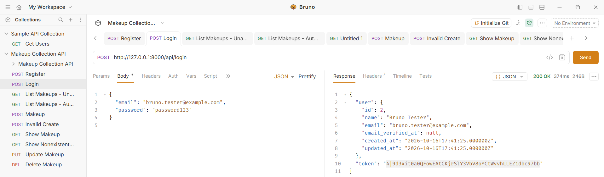
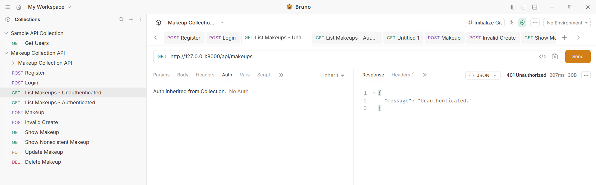
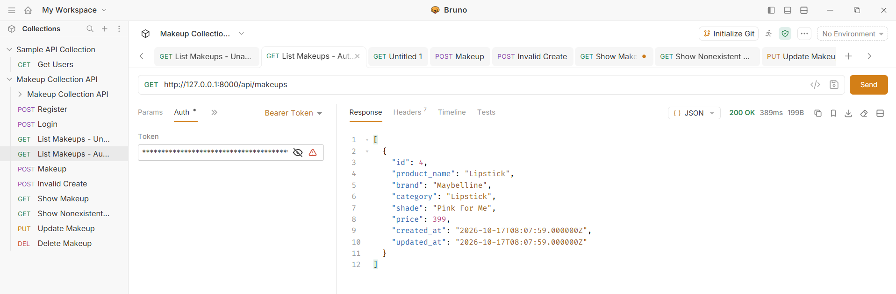
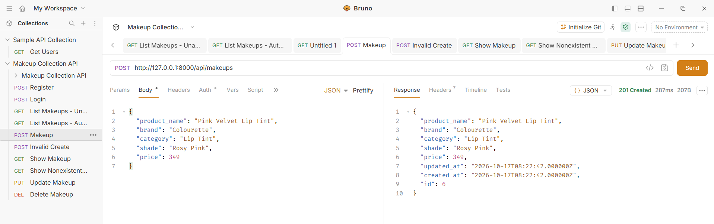
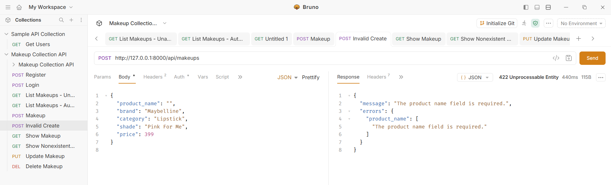
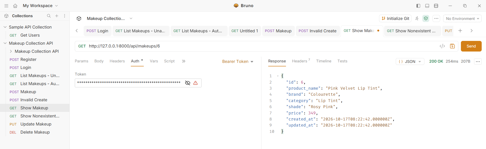
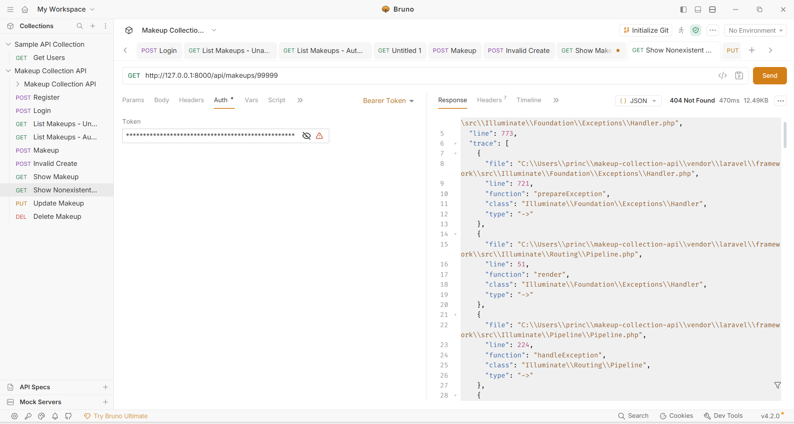
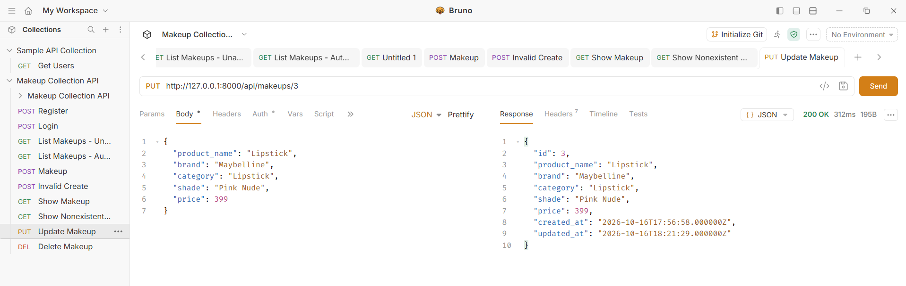
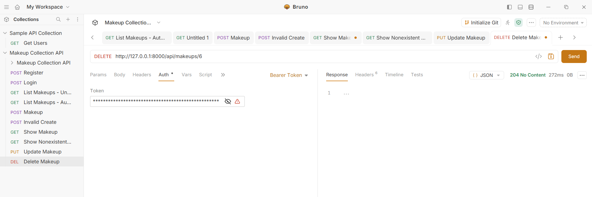

# Makeup Collection API

**Course:** CIT3102  
**Project:** Build Your Own API  
**Repository:** [cit3102-m5-makeup](https://github.com/xcecixx/cit3102-m5-makeup)

## Project Members

- **Name:** Princes Joy M. De la Cruz
- **Partner:** [Partner's Full Name]
- **Section:** IT3E

## Project Description

The Makeup Collection API is a RESTful API developed using Laravel. It allows users to register and log in, then manage a collection of makeup products. The API supports creating, viewing, updating, and deleting makeup records. It also supports filtering products by brand and category. Laravel Sanctum is used to protect the makeup endpoints through token-based authentication.

## Resource: Makeup

Each makeup record contains the following fields:

| Field | Description |
|---|---|
| `id` | Unique identifier of the makeup product |
| `product_name` | Name of the makeup product |
| `brand` | Brand of the product |
| `category` | Product category |
| `shade` | Product shade or color |
| `price` | Price of the product |
| `created_at` | Date and time the record was created |
| `updated_at` | Date and time the record was last updated |

## Technologies Used

- PHP
- Laravel
- Laravel Sanctum
- Bruno API Client
- Git
- GitHub

## Setup Instructions

### Prerequisites

Make sure the following are installed on your computer:

- PHP
- Composer
- Git

### Installation

**1. Clone the repository**

```bash
git clone https://github.com/xcecixx/cit3102-m5-makeup.git
```

**2. Navigate to the project folder**

```bash
cd cit3102-m5-makeup
```

**3. Install the project dependencies**

```bash
composer install
```

**4. Create the environment file**

For Windows PowerShell:

```powershell
Copy-Item .env.example .env
```

**5. Generate the application key**

```bash
php artisan key:generate
```

**6. Configure the database**

Configure the `.env` file to use SQLite. Make sure the database file `database/database.sqlite` exists. If it does not exist, create it using:

```powershell
New-Item database/database.sqlite -ItemType File
```

**7. Run the database migrations**

```bash
php artisan migrate
```

**8. Start the Laravel development server**

```bash
php artisan serve
```

The API will be available at:

`http://127.0.0.1:8000`

## API Routes

| HTTP Method | Endpoint | Description | Token Required |
|---|---|---|---|
| POST | `/api/register` | Register a new user and generate an access token | No |
| POST | `/api/login` | Authenticate a user and generate an access token | No |
| POST | `/api/logout` | Log out and revoke the current access token | Yes |
| GET | `/api/me` | Retrieve the authenticated user's information | Yes |
| GET | `/api/makeups` | Retrieve makeup products; supports filtering | Yes |
| POST | `/api/makeups` | Create a new makeup product | Yes |
| GET | `/api/makeups/{makeup}` | Retrieve a specific makeup product | Yes |
| PUT | `/api/makeups/{makeup}` | Update an existing makeup product | Yes |
| DELETE | `/api/makeups/{makeup}` | Delete a makeup product | Yes |

## Filtering Makeup Products

The API supports filtering makeup products by `brand` and `category`.

**Filter by brand**

```http
GET /api/makeups?brand=Colourette
```

**Filter by category**

```http
GET /api/makeups?category=Lipstick
```

**Combine both filters**

```http
GET /api/makeups?brand=Colourette&category=Lipstick
```

**Expected output:** `200 OK` when the request is authenticated and successful. The response contains only products matching the selected filters. If no products match, the API should return an empty array.

For protected endpoints, include the access token in the request header:

```http
Authorization: Bearer YOUR_ACCESS_TOKEN
Accept: application/json
```

## API Testing in Bruno

The following screenshots show the API requests and their actual responses in Bruno. Each test includes the expected HTTP status code.

### 1. User Registration

- **Method:** `POST`
- **Endpoint:** `/api/register`
- **Expected Output:** `201 Created`



### 2. User Login

- **Method:** `POST`
- **Endpoint:** `/api/login`
- **Expected Output:** `200 OK`



### 3. Unauthorized Request

- **Method:** `GET`
- **Endpoint:** `/api/makeups`
- **Expected Output:** `401 Unauthorized`



### 4. Retrieve All Makeup Products

- **Method:** `GET`
- **Endpoint:** `/api/makeups`
- **Expected Output:** `200 OK`



### 5. Create a Makeup Product

- **Method:** `POST`
- **Endpoint:** `/api/makeups`
- **Expected Output:** `201 Created`



### 6. Validation Error

- **Method:** `POST`
- **Endpoint:** `/api/makeups`
- **Expected Output:** `422 Unprocessable Content`

The API should reject invalid input and return validation errors.



### 7. Retrieve One Makeup Product

- **Method:** `GET`
- **Endpoint:** `/api/makeups/{makeup}`
- **Expected Output:** `200 OK`

Replace `{makeup}` with the ID of an existing makeup product.



### 8. Nonexistent Makeup Product

- **Method:** `GET`
- **Endpoint:** `/api/makeups/99999`
- **Expected Output:** `404 Not Found`

The API should return a not-found response when the requested makeup ID does not exist.



### 9. Update a Makeup Product

- **Method:** `PUT`
- **Endpoint:** `/api/makeups/{makeup}`
- **Expected Output:** `200 OK`

Replace `{makeup}` with the ID of an existing makeup product.



### 10. Delete a Makeup Product

- **Method:** `DELETE`
- **Endpoint:** `/api/makeups/{makeup}`
- **Expected Output:** `204 No Content`

A successful deletion returns no response body.



## Why Does DELETE Return 204 Instead of 200?

The DELETE endpoint returns `204 No Content` because the makeup product was successfully deleted. It does not need to return any message or data after deleting the record. A `200 OK` response can also be used if the API needs to send a confirmation message. In our API, we use `204 No Content` because there is nothing else to return after the deletion.

## Authentication and Security

The API uses Laravel Sanctum for token-based authentication. Users receive an access token after registration or login and must include it in the `Authorization: Bearer` header when accessing protected endpoints.

- Registration and login do not require authentication.
- Logout, user information, and makeup CRUD endpoints require a valid access token.
- The `.env` file, access tokens, and passwords should not be published in the repository.
- The `vendor/` directory is excluded through `.gitignore`.
